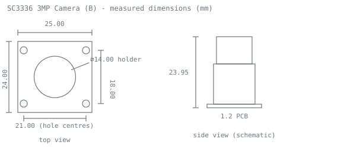
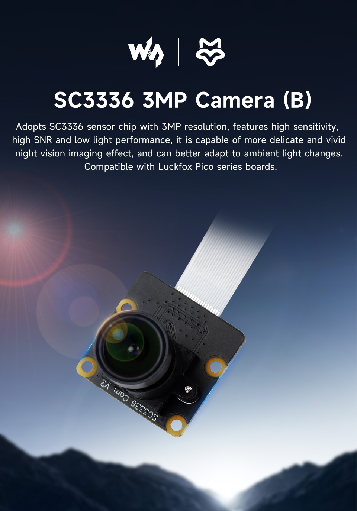
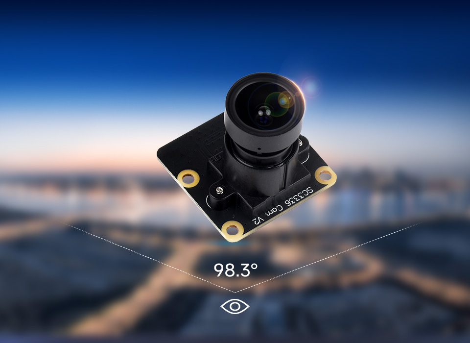
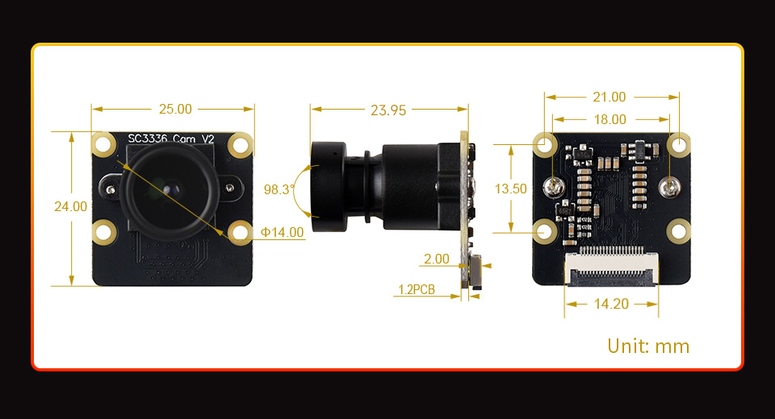

# Pool table -> OBS wireless streaming: engineering notes

Companion file: `CONVERSATION.md` (full conversation record).
Notes dated 2026-10-10 .. 2026-10-12.
Machine-specific paths, usernames and tracking parameters were removed for publication.

---

## 1. Goal (as clarified across the conversation)

A **colour** camera mounted **on the pool-table light fixture**, ~34 in above the
cloth, streaming **live and wirelessly** into **OBS**, which broadcasts to
**Facebook (primary)** and YouTube. No audio required. Camera and OBS PC are in
the same room.

Original ask was 4K; dropped to 2K to buy size and power; then effectively
resolved to **1080p** because Facebook caps there.

### Constraints, in the order they were settled

| Constraint | Status | Consequence |
|---|---|---|
| Wireless | yes | WiFi, same room, PC on Ethernet |
| Small / light | yes | must hang off a light fixture |
| Low power | yes | RV1106 class (~1 W), not an SBC |
| 4K -> 2K -> 1080p | resolved | FB caps at 1080p; 2K only helps YouTube |
| Latency | **irrelevant** | FB/YT add seconds of platform latency |
| Audio | not required | but FB ingest requires *an* AAC track |
| Power at camera | mains at fixture, or battery | not a battery problem any more |

---

## 2. THE binding constraint: field of view

Table: **7 ft = 78 x 39 in playing surface** (WPA-style, confirmed multiple sources).
Standard pool light height: **31-36 in above the cloth**, measured from the
bottom of the fixture.

```
HFOV_needed = 2 * atan(39 / h)      h = camera height above cloth
VFOV_needed = 2 * atan(19.5 / h)
DFOV_needed = 2 * atan(sqrt(tan^2(HFOV/2) + tan^2(VFOV/2)))   [16:9]
lens_f      = (sensor_active_width / 2) / tan(HFOV/2)          [1/2.8" -> 5.58 mm]
```

| h (in) | HFOV needed | VFOV needed | DFOV needed | lens (1/2.8") |
|---|---|---|---|---|
| 26 (slung below shade) | 112.6 deg | 73.7 deg | ~118 deg | ~1.85 mm |
| 31 (low end standard)  | 103.0 | 64.3 | 109.2 | 2.22 mm |
| **34 (assumed)**       | **97.8** | **59.7** | **104.1** | **2.43 mm** |
| 36 (high end standard) | 94.6 | 56.9 | 100.9 | 2.57 mm |
| 48 | 78.2 | 44.2 | 84.5 | 3.43 mm |
| 55 | 70.7 | 39.0 | 76.8 | 3.93 mm |
| 60 (ceiling) | 66.0 | 36.0 | 72.0 | 4.29 mm |

DFOV is the sensor-diagonal figure, computed exactly from the two tangent ratios
above; **HFOV is what binds** here, because the table is 2:1 and 39 in is the
dimension that exceeds a stock lens first (compare the covered width tables below).

**Escape hatch, quantified:** the stock 3.95 mm lens gives HFOV 70.4 deg, i.e.
**1.4122 in of table covered per inch of height**. So the stock lens covers the
78 in table at **h >= 55.2 in**, and with 10% margin at **h >= 60.9 in**.
If the camera can sit at/above the shades instead of below them, the lens
problem disappears entirely.

**At h=34 the stock cameras do not cover the table:**

| Stock module (colour) | HFOV | covers at 34 in | share of 78 in |
|---|---|---|---|
| SC3336 3MP | ~90.5 deg | 68.6 in | 88% |
| MIS5001 5MP @2.88 mm | 87.5 deg | 65.1 in | 83% |
| IMX415-98 | 84 deg | 61.2 in | 78% |
| MIS5001 5MP @4.15 mm | 78.2 deg | 55.3 in | 71% |
| *required* | *97.8 deg* | *78 in* | *100%* |

**Fisheye is the fix.** A ~2.2 mm M12 fisheye gives ~121 deg H on a
6.4 mm-diagonal sensor -> covers ~120 in at 34 in, i.e. 154% of the table,
leaving dewarp headroom. A 1.7-1.85 mm 180 deg lens over-covers and wastes
pixels. (The 121 deg is the *lens's own* figure, not something the rectilinear
relation predicts: at 2.2 mm on this sensor's 5.58 mm active width the
rectilinear formula gives only ~103 deg H, so the coverage above holds only if
the fisheye really delivers ~121 deg - measure it on arrival, as section 9
already requires.) Resolution cost of the wide lens: the table spans only ~65% of frame
width, so a 2.25 in ball renders ~36 px at 1080p (vs ~55 px if the table filled
the frame).

---

## 3. Verified component specs

### RV1106 (the chosen SoC)
- HW H.264/H.265 encode up to **5 MP @ 30 fps** (2592x1944). 1080p60 fits easily.
- ISP input: RV1106G3 8 MP @ 15 fps; RV1106G2 5 MP @ 30 fps.
- Luckfox Pico Ultra: **50 x 50 mm**, 8 GB eMMC, MIPI CSI 2-lane.
- Luckfox Pico Ultra W: adds **onboard 2.4 GHz WiFi 6 + BT5.2** (2.4 GHz only).
- Measured idle: **22 mA @ 5 V = 0.11 W** (Core1106/Ultra W, Luckfox forum).
- Luckfox Core1106 SoM: 30 x 30 mm. Pico Mini (RV1103): 28 x 21 mm, **no WiFi**.

### Luckfox camera modules (from Luckfox/Waveshare wikis)
| Module | Sensor | Lens | DFOV / HFOV / VFOV | Distortion |
|---|---|---|---|---|
| SC3336 3MP (A) and (B) | 1/2.8", 2304x1296 | 3.95 mm F2.0 | 98.3 / ~90.5 / ~59 | < 33% |
| MIS5001 5MP | 1/2.7", 2592x1944 | 4.15 mm F1.6 | 93 / 78.2 / 41 | < -10.7% |
| MIS5001 5MP | | 2.88 mm F2.4 | 95.5 / 87.5 / 56.5 | < 1% |
| IMX415-98 IR-CUT | 1/2.8", 3840x2160, 6.43 mm diag | 3.95 mm F2.0 | 98 / 84 / 44 | < 1% |
| IMX415 (A) | | 2.88 mm F2.4 | 95.5 / 87.5 | - |
| ISG1321 | 1.38 MP **MONO**, global shutter | 95.5 deg lens | - | excluded (mono) |

**(A) and (B) SC3336 are optically identical** (3.95 mm, F2.0, 98.3 deg, <33%,
manual focus) - they differ by FPC/connector and board pairing. Luckfox lists
**(B) for Ultra and Mini**, **(A) for Pro/Max**.

**SC3336 (B) mechanicals** - read off the vendor dimension drawing on 2026-10-12:
board **25.00 x 24.00 mm**, PCB 1.2 mm thick, mounting holes on **21.00 x 18.00 mm**
centres, **lens holder outer diameter 14.00 mm**, total lens + holder height
**23.95 mm** above the PCB. A 14 mm holder is the standard **M12 (S-mount)** size
(M8 would be ~10 mm, M16 ~18 mm), and the lens sits in a stepped holder with a
knurled focus ring and a retaining screw - consistent with the stated "manual
focus".



**Vendor reference images** (temporary - see the provenance note in the README):





*Images (c) Waveshare, from the [SC3336 3MP Camera (B)](https://www.waveshare.com/product/luckfox/cameras/3mp-cameras/sc3336-3mp-camera-b.htm)
product page, with further detail on the [SC3336 3MP Camera (A)](https://www.waveshare.com/sc3336-3mp-camera-a.htm)
page. Reproduced temporarily as illustrative reference and **not covered by this
repository's FSL-1.1-MIT licence** - copyright remains with Waveshare. The
diagram above is our own drawing made from the measurements in the vendor
drawing. Measurements are facts and free to use; the photographs are not ours.
These images are placeholders and will be replaced with photographs of our own
hardware once it is in hand.*

**SPEC WARNING:** Luckfox's focal lengths and FOV figures **contradict each
other**. 3.95 mm on a 6.43 mm-diagonal sensor is geometrically ~78 deg diagonal,
yet 98 deg is published; the H/V columns are not internally consistent with 16:9
either (MIS5001 @2.88 mm is the one self-consistent set). **Do not plan off the
datasheet. Measure the real coverage at the real height.**

---

## 4. Broadcast platform limits

| | Max | Notes |
|---|---|---|
| **Facebook Live** | **1080p** | H.264 Level 4.1 @1080p30, Level 4.2 @1080p60. 3,000-6,000 kbps @1080p30 (narrow 1080p envelope). Keyframe 2 s. |
| YouTube Live | up to 4K60 | 1440p60 ~24 Mbps, 1440p30 ~15 Mbps, 1080p60 ~12 Mbps |

**Facebook requires an audio track.** Live Video API reference: live video
"must: include both audio and video data", H264/AAC. Fix: keep one muted audio
source enabled in OBS so an AAC track is emitted (or `-f lavfi -i anullsrc` with
ffmpeg). Zero hardware cost.

**OBS ingestion rules:**
- WHIP in OBS is **output only** - it cannot be used as an input.
- Do **not** use OBS as an SRT *listener*: it cannot recreate the socket on
  reconnect while an output is active (obs-studio issue #13506).
- Correct chain: camera -> RTSP -> **MediaMTX** -> OBS **Media Source** ->
  platform RTMP(S). Alternative input plugin: `xacnio/live-stream-source`
  (SRT/HLS/WHEP/IVS).
- **RTSP reconnection is broken in OBS and no setting fixes it.** The Media
  Source's reconnect (`Reconnect Delay`, default 10 s) is armed only after
  FFmpeg's demuxer fires its *stop* callback; if the read thread instead blocks
  on a dead/half-open socket, no callback fires, `mediaState` stays `PLAYING`,
  and no log line or WebSocket event is emitted at all (obs-studio **#11537**,
  open since 2024-11-19; **#12958**, open, last updated 2026-08-15 - its
  reporter closed it with a third-party plugin, not an OBS fix). A watchdog
  therefore cannot read OBS's own state: `GetMediaInputStatus` keeps returning
  `PLAYING` and `MediaInputPlaybackEnded` fires only on a *clean* drop, never on
  the silent hang. What does work, outside OBS's state machine:
  (a) check the OBS host's TCP socket to `<camera>:554` and re-probe with an
  RTSP `DESCRIBE`/`OPTIONS` (this separates "camera down" from "source hung"),
  or (b) hash successive `GetSourceScreenshot` frames and flag "picture has not
  changed" (cause-agnostic). Re-arm with `TriggerMediaInputAction`
  `RESTART`/`STOP`, or toggle the scene item / re-apply the input settings, and
  confirm recovery via `MediaInputPlaybackStarted`.

**Resolution decision:** since Facebook caps at 1080p, **2K buys nothing for the
primary target.** Target 1080p60 (better ball tracking on break shots) or
1080p30.

---

## 5. Recommended build (DIY)

Architecture: `SC3336 -> RV1106 HW H.264 -> RTSP -> MediaMTX -> OBS Media Source -> FB/YT`

### Amazon, verified prices on 2026-10-11/12

| # | Item | Link | Price |
|---|---|---|---|
| 1 | Luckfox Pico Ultra (WiFi 6, RV1106, 8 GB eMMC) | https://www.amazon.com/dp/B0D8T54XJR | $62.39 |
| 2 | SC3336 3MP Camera (B) | https://www.amazon.com/dp/B0CJM7S6F6 | $15.99 |
| 3 | Commonlands 2.2 mm M12 lens, low distortion, 1/2.3", IP67, IR-corrected | https://www.amazon.com/dp/B0F3KZJKVQ | $47.00 |
| 4 | Voltaic **Always On** V50, 13,400 mAh / 48 Wh, USB-C PD | https://www.amazon.com/dp/B00XZ7YU4M | $74.00 |
| | **Total** | | **$199.38** |

Swap options:
- Voltaic V75 Always On, 20,100 mAh: https://www.amazon.com/dp/B084BPSFKH - $89.00
- Cheaper but too-wide fisheye, 2 mm 190 deg IR-corrected: https://www.amazon.com/dp/B0F1QRXTQP - $35.00
- Mains-tap instead of battery (only if NOT on the wall switch):
  DC 12/24 V -> 5 V USB-C 5 A: https://www.amazon.com/dp/B0CRVW7N2J - $8
  PlusRoc waterproof 12/24 -> 5 V 3 A: https://www.amazon.com/dp/B09DGDQ48H

### Cheaper non-Amazon sources for the same parts
| Part | Vendor | Price |
|---|---|---|
| Luckfox Pico Ultra W (sku 26790) | Waveshare direct | $50.99 |
| SC3336 3MP (B) | Waveshare direct | $8.99 |
| SC3336 3MP (B) | Luckfox direct | $8.99 |
| MIS5001 5 MP | Luckfox direct | $9.99 |
| Luckfox Pico Ultra B | Luckfox direct | $41.99 |
| Pico Ultra (WiFi) | Newegg (Waveshare storefront) | ~$67.19 |

Other Amazon variants to avoid confusing: B0DB23B79S $91.99, B0D6G7Z2BQ $74.99
(PoE), B0DB283LHG $87.99. **Check the bullets say "Onboard 2.4GHz WiFi 6".**

### Not required
- microSD (Ultra boots from 8 GB eMMC)
- USB-C cable (ships with the board; V50 has USB-A outputs)
- Audio hardware
- USB-serial adapter (flashing is over USB-C)

### Power budget
| State | Draw |
|---|---|
| Idle | 0.11 W (measured) |
| Streaming (WiFi + HW encode) | ~1.5-2.5 W (estimate) |

| Bank | Runtime @ 2 W |
|---|---|
| 10,000 mAh (~37 Wh) | ~12 h |
| 13,400 mAh (V50, 48 Wh) | ~19 h |
| 20,000 mAh (~74 Wh) | ~30 h |

**Must be an "always on" bank:** most power banks auto-shutoff below ~50-100 mA,
and 0.11 W idle is far below that.

---

## 6. Retail alternatives (prebuilt)

| Option | Product | Price | Wireless | OBS path | FOV at 34 in |
|---|---|---|---|---|---|
| Purpose-built | **Mevo Core** - 4K MFT, **interchangeable lens**, 6 h battery, WiFi 6E | $949.99 new / **$699.99 refurb** | yes | **native NDI + SRT**, also RTMP | you choose the lens |
| Purpose-built 1080p | Mevo Start - 1080p, 4 h battery | ~$599.99 (was $299) | yes | RTMP / USB webcam / PoE adapter | fixed lens |
| WiFi IP camera | Tapo (non-battery) / Reolink, 2K-4K | $40-120 | WiFi | **RTSP** -> OBS Media Source | only if HFOV >= 98 deg |
| Spare phone | NDI Camera / NDI HX app -> obs-ndi plugin | $0-30 | WiFi | NDI | ultra-wide ~100-110 deg OK |
| Pro fisheye | Hikvision DS-2CD6365G0E-I(V)S, 6 MP, **on-board dewarp** | $300-600 | PoE (wired) | RTSP (dewarped) | 360 deg |

**Mevo Core** is the only retail product that solves the FOV problem natively
(Micro Four Thirds = pick a rectilinear wide lens; no fisheye, no dewarping),
with native NDI/SRT into OBS.

**Retail traps:**
- **Battery-powered cameras do not do RTSP.** TP-Link FAQ: most Tapo cameras
  *excluding battery-powered models* support RTSP/ONVIF Profile S.
- **Most IP cameras are narrower than assumed.** e.g. Tapo C225 is a **4.3 mm**
  lens on 1/2.9" (~65-70 deg HFOV) - nowhere near enough. Genuinely wide models
  are ~2.8-3.17 mm / 110-125 deg diagonal specific SKUs.
- All are bulky relative to a light fixture.

**Decision rule:**
- Camera can be big or move to the **ceiling** -> buy retail (best value in the
  whole thread; at 60 in even a stock lens covers the table).
- Must hang on the **fixture** -> build the RV1106 rig; it is the only option
  small enough, which is the sole remaining advantage of DIY.

---

## 7. Rejected options and why

| Option | Reason |
|---|---|
| Raspberry Pi 5 | hardware H.264 encoder removed; only HEVC decode |
| ESP32-S3 | no HW H.264; sensor-side JPEG only. 1080p30 JPEG = 36-72 Mbps vs 10-20 Mbps real 2.4 GHz WiFi -> ~4-6 fps |
| ESP32-C5 | **no video path at all** - zero hits for camera/CSI/DVP/JPEG/H.264/encoder in the module datasheet |
| ESP32-P4 | 1080p30 HW H.264 but **no onboard WiFi** (pairs with C6/C5); dev-board class |
| RK3566 / Radxa Zero 3W | 1080p-only encoder |
| RK3588 (Orange Pi 5 etc.) | 5-12 W, 62 x 100 mm - not small, not low power |
| Battery IP cameras | do not expose RTSP |
| 4K generally | FB cannot use it; optics get harder, not easier |

---

## 8. Open risks / unverified

1. ~~**SC3336 lens mount: M12 vs M8.**~~ **RESOLVED 2026-10-12, by inspection of
   the vendor dimension drawing** (measurements in section 3). The lens holder
   outer diameter is **14.00 mm**, which is the standard **M12 (S-mount)** size -
   M8 would be ~10 mm and M16 ~18 mm. The lens sits in a stepped holder with a
   knurled focus ring and a retaining screw, matching the "manual focus" spec.
   **Stock M12 micro-lenses should fit, so the 2.2 mm fisheye plan stands.**
   Residual risk is reduced but not eliminated: the thread is not stated in
   writing anywhere, and a replacement lens still needs a compatible back focal
   length to reach focus at 34 in. Verify by hand on arrival before ordering the
   lens.
2. **Fixtures on the wall switch.** If the light switch controls the fixture,
   tapping its power kills the camera whenever the lights go off. Never tap a
   dimmed circuit.
3. **IR-cut filter location** if the stock lens is swapped - may be in the lens
   assembly, which would cause a colour cast.
4. **LED/fluorescent flicker banding** - a shop light is a switched driver;
   rolling-shutter sensors band under PWM. Set anti-flicker to 60 Hz and check
   for rolling bars across the cloth.
5. **Published FOV figures contradict their own focal lengths** (see section 3).
6. Liquids/Li-ion: do not strap a battery to a hot fixture.
7. **Tapo C325WB security (the retail route).** The three advisories the RESUME
   lists are real - CVE-2026-105672 (unauthenticated JSON-API auth bypass, 8.7),
   CVE-2026-105673 (unauthenticated RTSP-over-HTTP DoS, 7.1) and
   CVE-2026-105674 (predictable media-stream pre-shared key, 8.7) - all
   adjacent-network, **all V2 hardware only**, published 2026-10-08 and
   **fixed in V2 firmware `V2_1.3.3 Build 260914`** (TP-Link faq/5333; V1/V1.60
   is not listed as affected). Note 673 requires the **Camera Account feature to
   be enabled** - exactly what the RTSP/OBS route needs - so this update is
   mandatory, not hygiene. Update on arrival; keep the camera off untrusted
   networks.

---

## 9. Verification plan (the gate - do this before buying more)

1. Tape-measure the real height from cloth to the intended camera position.
   (Currently assumed 34 in.)
2. Compute HFOV needed = 2*atan(39/h); compare with the lens on hand.
3. Buy board + SC3336 first. Power it, point it down at h, and confirm:
   - all four **corner pockets** are inside the frame with margin
   - the 78 in length and 39 in width both fit
4. Check for flicker banding under the actual fixture.
5. 30-minute RTSP soak for stream stability.
6. Only then buy the mount, the lens and the shield.

---

## 10. Quick reference numbers

```
7 ft table playing surface ...... 78 x 39 in
standard light height ........... 31-36 in above cloth (60-66 in above floor)
assumed camera height ........... 34 in
HFOV needed @ 34 in ............. 97.8 deg
DFOV needed @ 34 in ............. 104.1 deg (diagonal; HFOV 97.8 is the binding one)
lens needed @ 34 in ............. ~2.43 mm on 1/2.8"
stock lens ...................... 3.95 mm -> covers 1.4122 in per inch of height
stock lens covers 78 in at ...... h >= 55.2 in
stock lens + 10% margin at ...... h >= 60.9 in
fisheye sweet spot .............. 2.2 mm M12 (~121 deg H, the lens's own spec - verify on arrival)
RV1106 encode ceiling ........... 5 MP @ 30 fps (HW H.264/H.265)
RV1106 idle power ............... 0.11 W (22 mA @ 5 V)
Facebook Live max ............... 1080p, 3-6 Mbps, keyframe 2 s, AAC required
YouTube Live max ................ up to 4K60
DIY build total ................. $199.38 (Amazon, 2026-10-11/12)
retail turnkey .................. $699-950 (Mevo Core)
```

## 11. Key source links

- Luckfox cameras: https://wiki.luckfox.com/Cameras/
- RV1106 datasheet: https://rockchip.fr/RV1106%20datasheet%20V2.0.pdf
- Prior art (RV1106 RTSP, Frigate): https://github.com/SobolevTim/luckfox-frigate-cam
- Luckfox RKMPI RTSP examples: https://github.com/LuckfoxTECH/luckfox_pico_rkmpi_example
- OBS SRT guide: https://obsproject.com/kb/srt-protocol-streaming-guide
- OBS SRT listener bug: https://github.com/obsproject/obs-studio/issues/13506
- Facebook Live API requirements: https://developers.secure.facebook.com/docs/live-video-api/reference
- YouTube encoder settings: https://support.google.com/youtube/answer/2853702
- MediaMTX: https://mediamtx.org/docs/publish/raspberry-pi-cameras
- OpenIPC (SSC338Q low-latency alternative): https://openipc.org/
